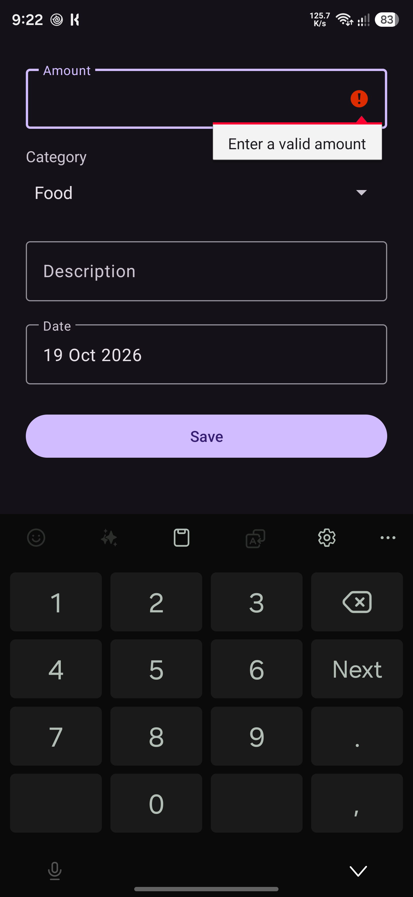
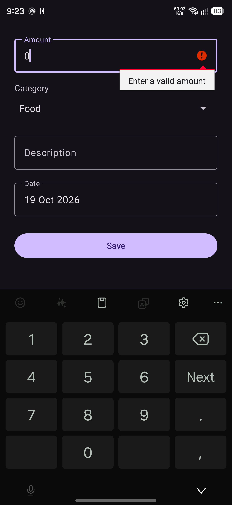
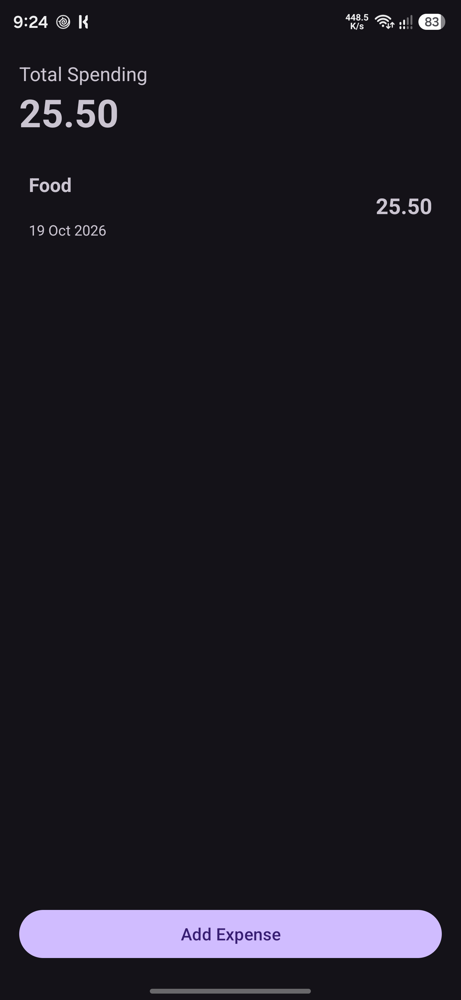
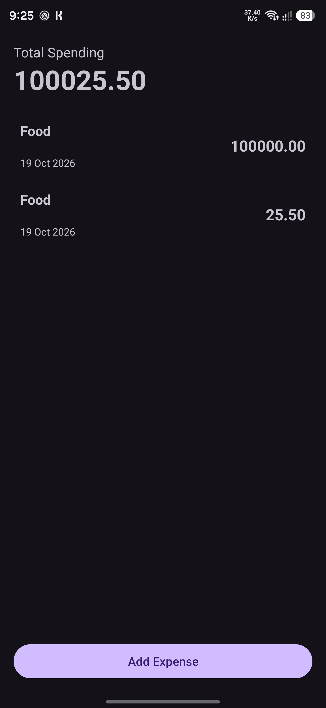
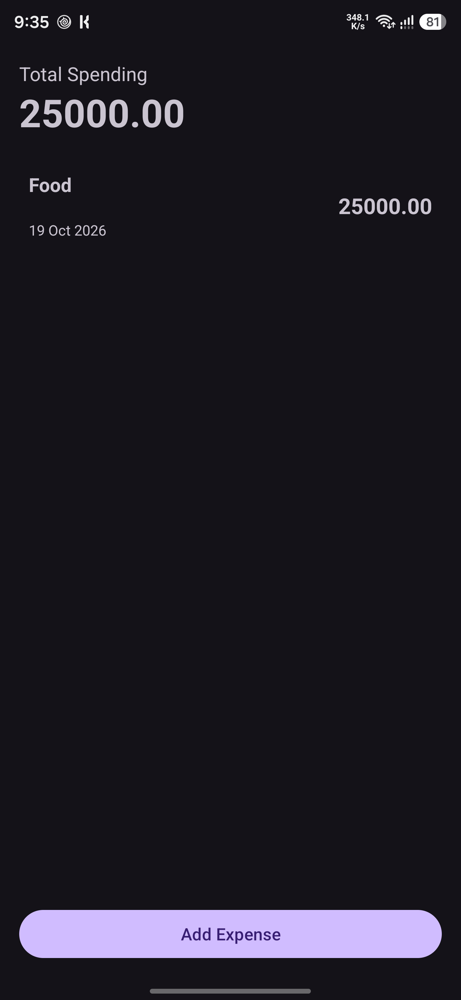
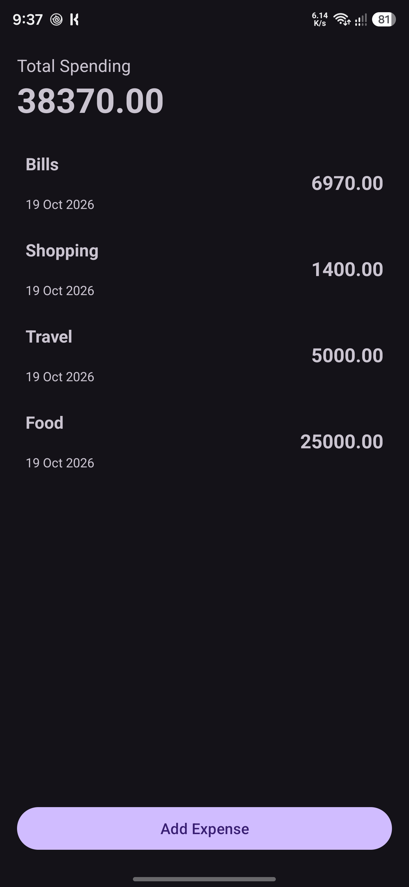
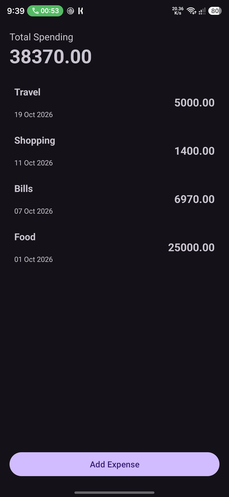
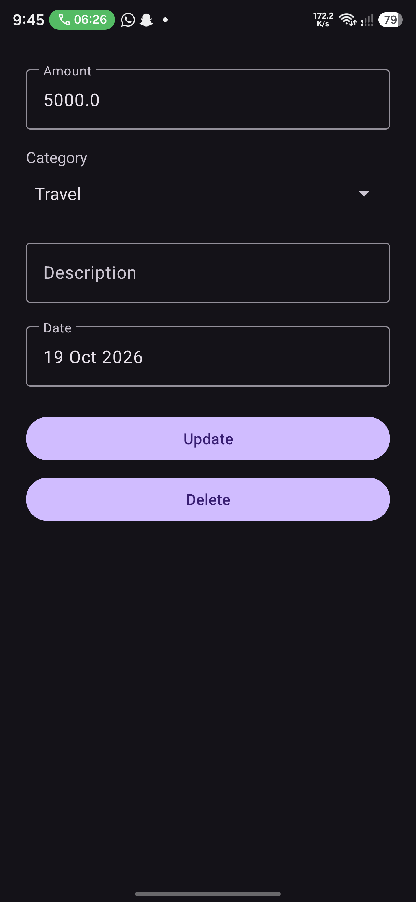
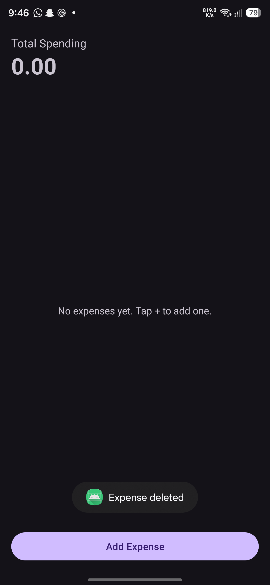

# Expense Tracker

An Android app for recording and managing daily expenses. Expenses are stored locally on the device with a Room database, so they stay saved after the app is closed.

Built as **Task 2** of the Auspify Technologies Android Developer Internship.

## Features

- Add expenses with an amount, category, description and date
- Categories: Food, Travel, Shopping and Bills
- Expense history sorted by newest date first
- Total spending that updates automatically
- Edit and delete expenses (delete asks for confirmation)
- Date picker for choosing the expense date
- Input validation for empty or zero amounts
- Data stays saved after the app is closed
- Edits survive screen rotation

## Tech Stack

- Kotlin
- Android Studio, XML layouts, View Binding
- Room database (with KSP)
- Kotlin Coroutines and Flow
- RecyclerView with ListAdapter and DiffUtil
- Material Components

## Screenshots

| Empty amount | Zero amount | Decimal amount |
|---|---|---|
|  |  |  |

| Large amount | Empty description | Categories |
|---|---|---|
|  |  |  |

| Sorted by date | Update expense | Delete expense |
|---|---|---|
|  |  |  |

## How to Run

1. Clone the repository
2. Open it in Android Studio
3. Let Gradle sync
4. Run on an emulator or a device with Android 10 (API 29) or higher

## Author

Ameer, Auspify Android Developer Intern